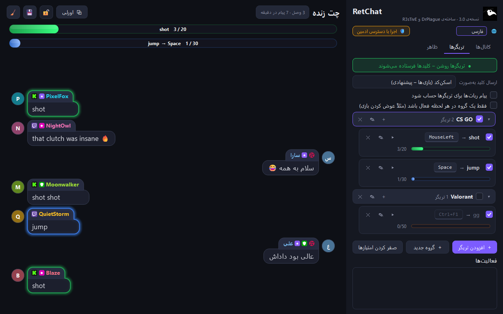
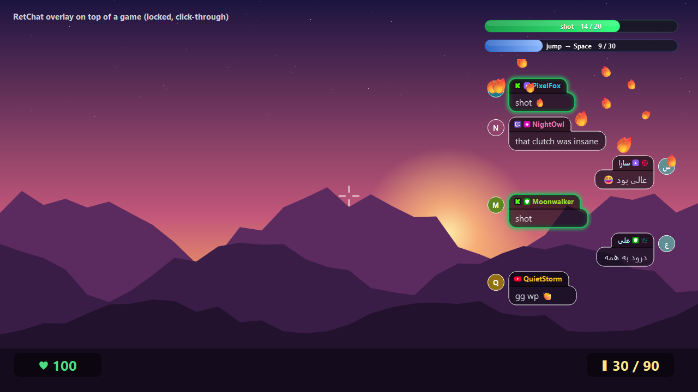

<div dir="rtl">

<div align="center">

[English](README.md) · **فارسی**

# RetChat

**چت زنده‌ی Twitch، Kick، YouTube، آپارات (کص مادرشون) و OneFa را در یک پنجره بخوانید، آن را به‌صورت اورلی روی بازی یا استریم‌تان نمایش دهید و بگذارید چت شما در بازی کلید بزند.**

ساخته‌ی **DrPlague** و **R3sTivE** · استریم R3sTivE در Kick: **[kick.com/r3stive](https://kick.com/r3stive)**



</div>

---

## فهرست

- [امکانات](#امکانات)
- [🎮 استفاده به‌عنوان اورلی](#اورلی)
- [حریم خصوصی: RetChat هیچ داده‌ای جایی نمی‌فرستد](#حریم-خصوصی)
- [پلتفرم‌های پشتیبانی‌شده](#پلتفرمهای-پشتیبانیشده)
- [دانلود و اجرا](#دانلود-و-اجرا)
- [آموزش](#آموزش)
  - [بالای پنجره](#بالای-پنجره)
  - [تب کانال‌ها](#تب-کانالها)
  - [تب تریگرها](#تب-تریگرها)
  - [ویرایشگر تریگر](#ویرایشگر-تریگر)
  - [تب ظاهر](#تب-ظاهر)
  - [بخش چت و اورلی](#بخش-چت-و-اورلی)
  - [OBS](#obs)
- [رفع مشکل](#رفع-مشکل)
- [اجرا از سورس / ساخت فایل exe](#اجرا-از-سورس--ساخت-فایل-exe)
- [مجوز](#مجوز)

---

## امکانات

- **پنج پلتفرم با هم**: ‏Twitch، ‏Kick، ‏YouTube، آپارات و OneFa در یک چت، بدون نیاز به مرورگر.
- **نشان‌ها، ایموت‌ها و عکس پروفایل** از همه‌ی پلتفرم‌ها، همراه با ایموت‌های متحرک GIF.
- **تریگرها**: وقتی چت یک کلمه (مثلاً `shot`) را به اندازه‌ی کافی بنویسد، RetChat یک کلید یا دکمه‌ی ماوس را در بازی فشار می‌دهد. امتیاز برای هر نقش، حد امتیاز، زمان استراحت و گروه‌بندی (مثلاً *CS GO* و *Valorant*).
- **چت می‌تواند کلیدها، کل کیبورد یا ماوس را** برای چند ثانیه **مسدود کند** یا **کامپیوتر را خاموش کند** (با پنجره‌ای برای لغو).
- **احترام به مدیریت چت**: پیام‌هایی که مدیرها پاک می‌کنند و پیام کاربرانی که بن یا تایم‌اوت می‌شوند از برنامه، اورلی و OBS حذف می‌شوند. چت مخصوص مدیرهای آپارات هیچ‌وقت نمایش داده نمی‌شود.
- **کار در بازی‌ها**: کلیدها به‌صورت اسکن‌کد سخت‌افزاری فرستاده می‌شوند که بازی‌ها واقعاً آن را می‌خوانند.
- **چت زیبا**: حباب‌های گوشه‌گرد با نام بالای پیام، تم‌های رنگی آماده، درخشش پیام‌های تریگر، انیمیشن ورود، محو شدن و باران ایموجی (روی چت، روی کل صفحه‌ی نمایش، یا به‌عنوان منبع جداگانه در OBS).
- **اورلی و OBS**: پنجره‌ی شفاف چت که همیشه روی بقیه می‌ماند، و یک صفحه‌ی وب برای افزودن به OBS به‌عنوان Browser source (حتی از کامپیوتر دیگر).
- **پروکسی جدا برای هر کانال** برای شبکه‌هایی که بعضی سایت‌ها در آن‌ها فیلتر است.
- **رابط فارسی و انگلیسی** با پشتیبانی کامل راست به چپ.

<a id="اورلی"></a>
## 🎮 استفاده به‌عنوان اورلی

**RetChat برای استفاده به‌عنوان اورلی چت ساخته شده است**؛ هم روی صفحه‌ی خودتان هنگام بازی و هم روی استریم.



<sub>نمونه: اورلی RetChat روی یک بازی (صحنه‌ی بازی فقط برای این تصویر ساخته شده است).</sub>

**۱. روی صفحه‌ی خودتان، روی بازی**
- روی **⧉ اورلی** (بالای بخش چت) بزنید. یک پنجره‌ی شفاف چت باز می‌شود که همیشه روی پنجره‌های دیگر، از جمله بازی، می‌ماند.
- آن را به هر جا که می‌خواهید بکشید و اندازه‌اش را از گوشه‌ی پایین تغییر دهید.
- روی **🔓** بزنید تا **قفل** شود: اورلی **کلیک‌گذر** می‌شود و کلیک‌های ماوس به بازی زیرش می‌رسد. برای باز کردن دوباره، در پنجره‌ی اصلی روی **🔒** بزنید.
- بازی را در حالت **پنجره‌ای** یا **تمام‌صفحه‌ی بدون حاشیه (Borderless)** اجرا کنید. حالت تمام‌صفحه‌ی انحصاری (Exclusive Fullscreen) همه‌ی پنجره‌های روی بازی را پنهان می‌کند.

**۲. روی استریم (OBS)**
- در **ظاهر ← منبع مرورگر OBS** گزینه‌ی **نمایش چت به‌صورت صفحه‌ی وب** را تیک بزنید و یک لینک کپی کنید.
- در OBS: ‏**Sources ← + ← Browser**، لینک را بچسبانید. پس‌زمینه شفاف است و فقط پیام‌ها و نوارها روی استریم دیده می‌شوند. جزئیات، از جمله OBS روی کامپیوتر دیگر، در بخش [OBS](#obs) است.

**نکته‌هایی برای اورلی زیباتر**
- **تم ← شیشه‌ای** (پیام‌های نیمه‌شفاف) و **شفافیت کل چت ۰٪** تا فقط پیام‌ها دیده شوند.
- **تعداد پیام‌های نمایش‌داده‌شده: ۵** و/یا **محو شدن بعد از: ۱۰ ثانیه** تا چت روی بازی را نپوشاند.
- **پیام جدید: ورود از سمت خودش**، **درخشش پیام‌های تریگر** و **باران ایموجی** واکنش‌های چت را برای بیننده‌ها دیدنی می‌کنند.
- **نوارهای پیشرفت** تریگرها بالای اورلی نمایش داده می‌شوند و وقتی تریگر اجرا شود می‌درخشند.
- **باران ایموجی روی کل صفحه**: در **ظاهر ← باران ایموجی** گزینه‌ی **باران روی کل صفحه‌ی نمایش هم ببارد** را تیک بزنید تا ایموجی‌ها روی بازی ببارند، نه فقط روی چت.
- **باران ایموجی روی استریم**: لینک **فقط باران** در بخش OBS را به‌عنوان یک منبع Browser جدا با اندازه‌ی کل صفحه اضافه کنید تا باران کل استریم را بپوشاند (بخش [OBS](#obs)).

<a id="حریم-خصوصی"></a>
## حریم خصوصی: RetChat هیچ داده‌ای جایی نمی‌فرستد

- RetChat **حساب کاربری، ورود، آمارگیری و تله‌متری ندارد** و هیچ چیزی برای سازندگان یا هیچ شخص ثالثی نمی‌فرستد.
- فقط به **سرورهای چت کانال‌هایی که خودتان اضافه می‌کنید** (و سرورهای تصویر آن‌ها برای نشان‌ها، ایموت‌ها و عکس پروفایل) وصل می‌شود تا **چت عمومی را بخواند**؛ درست مثل وقتی که در مرورگر استریم را تماشا می‌کنید. در چت چیزی نمی‌نویسد.
- این اتصال‌ها از مسیری انجام می‌شود که برای هر کانال انتخاب می‌کنید (مستقیم، پروکسی شما یا پروکسی ویندوز).
- تنظیمات فقط روی کامپیوتر خودتان در `%USERPROFILE%\.retchat2_settings.json` ذخیره می‌شود و تصویرهای دانلودشده در `%USERPROFILE%\.ret_chat_cache` نگه داشته می‌شوند.
- کلیدها، مسدود کردن ورودی و خاموش کردن فقط روی کامپیوتر خودتان انجام می‌شوند. صفحه‌ی OBS فقط روی کامپیوتر خودتان (یا اگر روشنش کنید، روی شبکه‌ی محلی‌تان) در دسترس است.

## پلتفرم‌های پشتیبانی‌شده

| پلتفرم | چه چیزی بچسبانید | نشان‌ها | عکس پروفایل |
|---|---|---|---|
| **Twitch** | `twitch.tv/name` | ✓ تصویر رسمی نشان‌ها | ✓ |
| **Kick** | `kick.com/name` | ✓ نشان اشتراک، مدیر / VIP / OG و… | ✓ |
| **YouTube** | `youtube.com/@name` یا لینک لایو `watch?v=` | ✓ عضو / مدیر / صاحب کانال | ✓ |
| **آپارات** | `aparat.com/name` | ✓ ماه‌های اشتراک، مدیر / VIP | ✓ |
| **OneFa** | `onefa.ir/name` | ✓ اشتراک / مدیر / VIP / OG / دوست | ✓ |

## دانلود و اجرا

1. به صفحه‌ی **[Releases](../../releases)** بروید و فایل `RetChat_x.y.exe` را دانلود کنید.
2. روی آن دو بار کلیک کنید. نیازی به نصب نیست (ویندوز ۱۰ / ۱۱).
3. ممکن است ویندوز پیام *«Windows protected your PC»* نشان دهد چون برنامه امضای دیجیتال ندارد: روی **More info ← Run anyway** بزنید.

---

## آموزش

### بالای پنجره

| بخش | کاربرد |
|---|---|
| **🌐 زبان** | انتخاب **English** یا **فارسی**. برنامه با زبان انتخاب‌شده دوباره اجرا می‌شود. |
| **🛡 اجرا با دسترسی ادمین** | بازی‌هایی که با دسترسی ادمین اجرا می‌شوند کلیدهای برنامه‌های معمولی را نادیده می‌گیرند. با این دکمه RetChat با دسترسی ادمین دوباره اجرا می‌شود. اگر از قبل این دسترسی را داشته باشد، **ادمین ✓** نشان می‌دهد. |

### تب کانال‌ها

| بخش | کاربرد |
|---|---|
| **کادر لینک کانال** | لینک Twitch، ‏Kick، ‏YouTube، آپارات یا OneFa را بچسبانید و **افزودن** (یا Enter) را بزنید. |
| **کادر مسیر (کنار افزودن)** | کانال جدید چطور وصل شود: **مستقیم**، **پروکسی** یا **پروکسی سیستم**. |
| **سرور پروکسی** | پروکسی شما برای کانال‌هایی که مسیرشان «پروکسی» است: نوع (SOCKS5 / HTTP)، آدرس و پورت. ‏v2ray / xray معمولاً از SOCKS5 روی `127.0.0.1:10808` استفاده می‌کنند. |
| **آزمایش** | بررسی می‌کند که پروکسی به اینترنت وصل است. |
| **سیستم: …** | پروکسی تنظیم‌شده در ویندوز را نشان می‌دهد (برای حالت «پروکسی سیستم»). |
| **ردیف هر کانال** | لوگوی پلتفرم، نام، وضعیت (وصل / خطا) و تعداد پیام‌ها. |
| **مسیر (روی هر کانال)** | تغییر نحوه‌ی اتصال همان کانال؛ بلافاصله دوباره وصل می‌شود. |
| **اتصال / قطع** | شروع یا توقف خواندن چت آن کانال. |
| **✕** | حذف کانال. |
| **اتصال همه / قطع همه** | شروع یا توقف همه‌ی کانال‌ها. |

> اگر کانالی خطایی مثل *«DNS lookup failed»* یا *«Can't connect»* نشان داد، **مسیر** آن را روی **پروکسی** یا **پروکسی سیستم** بگذارید.

### تب تریگرها

**تریگر** وقتی چت یک کلمه را به اندازه‌ی کافی بنویسد کاری انجام می‌دهد: یک کلید را فشار می‌دهد، کلیدها / کیبورد / ماوس را چند ثانیه مسدود می‌کند، یا کامپیوتر را خاموش می‌کند. هر پیام منطبق، بسته به نقش فرستنده (مدیر، مشترک، VIP، عادی) امتیاز اضافه می‌کند. وقتی امتیاز به حد تعیین‌شده برسد، کار انجام می‌شود و شمارش از نو شروع می‌شود.

| بخش | کاربرد |
|---|---|
| **تریگرها روشن / متوقف** | کلید اصلی. در حالت توقف، هیچ کاری انجام نمی‌شود، امتیازی شمرده نمی‌شود و نواری نمایش داده نمی‌شود. |
| **ارسال کلید به‌صورت** | **اسکن‌کد** (پیشنهادی برای بازی‌ها) یا **کلید مجازی** (برای برنامه‌های معمولی ویندوز). |
| **پیام ربات‌ها برای تریگرها حساب شود** | به‌طور پیش‌فرض خاموش است تا کلمه‌ای که یک ربات (مثلاً RestreamBot) بازپخش می‌کند دو بار شمرده نشود. |
| **فقط یک گروه در هر لحظه فعال باشد** | با فعال کردن یک گروه، بقیه خاموش می‌شوند (مناسب برای عوض کردن بازی). |
| **سرتیتر گروه** | **☑ فعال** همه‌ی تریگرهای گروه را روشن یا خاموش می‌کند · **▾** باز / بسته کردن · **+** افزودن تریگر به گروه · **✎** تغییر نام · **✕** حذف. |
| **ردیف تریگر** | **☑** فعال / غیرفعال · کلمه **←** کار (مثلاً `MouseLeft`، `⛔ W 5s`، `⏻ 30s`) · **▶** آزمایش (کار را ۳ ثانیه بعد انجام می‌دهد تا به بازی بروید) · **✎** ویرایش · **✕** حذف · نوار، امتیاز فعلی را نشان می‌دهد. |
| **+ افزودن تریگر** | ویرایشگر تریگر را باز می‌کند. |
| **+ گروه جدید** | ساخت گروه، مثلاً *CS GO* یا *Valorant*. |
| **صفر کردن امتیازها** | امتیاز همه‌ی تریگرها را صفر می‌کند. |
| **فعالیت‌ها** | گزارش تریگرهای اجراشده، کلیدهای زده‌شده و خطاها. |

### ویرایشگر تریگر

| بخش | کاربرد |
|---|---|
| **گروه** | تریگر در کدام گروه باشد. برای ساخت گروه جدید، نام تازه بنویسید. |
| **وقتی چت بنویسد…** | کلمه و نحوه‌ی تطبیق: کل پیام همین کلمه باشد، پیام این کلمه را داشته باشد، این متن را هر جایی داشته باشد، یا با این کلمه شروع شود. حروف «ی/ي» و «ک/ك» یکسان در نظر گرفته می‌شوند. |
| **…آن‌وقت** | وقتی تریگر اجرا شود چه اتفاقی بیفتد (جدول *کارها* در پایین). |
| **کلید** | برای *یک کلید بزنید*: کلید، ترکیب کلید یا دکمه‌ی ماوس. روی **⏺ ضبط** بزنید و کلید را فشار دهید، یا آن را بنویسید (مثلاً `Ctrl+F1`، `Space`، `MouseLeft`). برای *مسدود کردن کلیدها*: یک یا چند کلید که با ویرگول جدا شده‌اند (مثلاً `W, A, S, D` یا `MouseLeft`). |
| **نگه داشتن به مدت / تکرار** | برای *یک کلید بزنید*: کلید چه مدت پایین بماند (بازی‌ها معمولاً ۵۰ تا ۱۵۰ میلی‌ثانیه لازم دارند) و چند بار زده شود. |
| **به مدت / خاموش شدن بعد از** | برای مسدود کردن: چند ثانیه مسدود بماند. برای *خاموش کردن*: چند ثانیه بعد ویندوز خاموش شود (حداقل ۱۰ ثانیه). |
| **▶ آزمایش در ۳ ثانیه** | کار را ۳ ثانیه بعد انجام می‌دهد تا در بازی امتحانش کنید (برای *خاموش کردن* در دسترس نیست). |
| **چه کسی و چقدر امتیاز می‌دهد** | کدام نقش‌ها مجازند و پیام هر نقش چند امتیاز می‌دهد. |
| **اجرا وقتی امتیاز برسد به** | حد امتیاز. |
| **استراحت بعد از اجرا** | چند ثانیه بعد از زدن کلید، چیزی شمرده نمی‌شود. |
| **هر بیننده در هر دور فقط یک بار حساب شود** | جلوی پر شدن نوار با اسپم یک نفر را می‌گیرد. |
| **نمایش نوار پیشرفت** / **رنگ نوار** / **نمایش کلید روی نوار** | نوار بالای چت نمایش داده شود یا نه، رنگ آن (برای درخشش هم استفاده می‌شود)، و اینکه روی نوار `shot → MouseLeft` نوشته شود یا فقط `shot`. |

**کارها (…آن‌وقت)**

| کار | چه می‌کند |
|---|---|
| **یک کلید بزنید** | کلید یا دکمه‌ی ماوس را در بازی فشار می‌دهد. |
| **مسدود کردن کلیدها** | کلیدها / دکمه‌های ماوس نوشته‌شده برای مدت تعیین‌شده کار نمی‌کنند؛ مثلاً `W, A, S, D` را مسدود کنید تا ۵ ثانیه نتوانید راه بروید. |
| **مسدود کردن کل کیبورد** | همه‌ی کلیدها برای مدت تعیین‌شده کار نمی‌کنند. کلیدهایی که خود RetChat برای تریگرهای دیگر می‌زند کار می‌کنند. |
| **مسدود کردن ماوس** | حرکت، دکمه‌ها و چرخ ماوس برای مدت تعیین‌شده کار نمی‌کنند. |
| **خاموش کردن کامپیوتر** | ویندوز بعد از این مدت کامپیوتر را خاموش می‌کند. RetChat پنجره‌ای با دکمه‌ی **لغو خاموش شدن** نشان می‌دهد. کارهای ذخیره‌نشده از بین می‌روند، پس حد امتیاز را بالا بگذارید. |

> **مسدود شدن همیشه خودش تمام می‌شود** (حداکثر ۱۰ دقیقه). **حالت اضطراری: ۵ بار سریع Esc بزنید** تا همه آزاد شوند. ‏Ctrl+Alt+Del هم همیشه کار می‌کند. اگر بازی با دسترسی ادمین اجرا شده، **اجرا با دسترسی ادمین** را بزنید تا ویندوز اجازه‌ی مسدود کردن ورودی آن را بدهد.

### تب ظاهر

| گزینه | کاربرد |
|---|---|
| **فونت / اندازه** | فونت و اندازه‌ی متن چت. |
| **چیدمان** | **حبابی** (گوشه‌گرد، نام بالای پیام) یا **فشرده** (هر پیام یک خط). |
| **تم** | تم‌های رنگی آماده با یک کلیک: نیمه‌شب، نئون، اقیانوس، جنگل، غروب، رز، طلایی، روشن و شیشه‌ای (نیمه‌شفاف). بعد از آن هم می‌توانید هر رنگ را جداگانه تغییر دهید. |
| **رنگ‌ها** | رنگ متن پیام، نام، پس‌زمینه‌ی پیام، پس‌زمینه‌ی نام، حاشیه‌ی پیام و پس‌زمینه‌ی کل چت. |
| **شفافیت پیام / کل چت** | میزان شفافیت کادر پیام‌ها و کل ناحیه‌ی چت. |
| **اندازه‌ی نام** | اندازه‌ی نام نسبت به متن پیام. |
| **گردی گوشه‌ها / ضخامت حاشیه** | شکل کادر پیام‌ها. |
| **پیام جدید** | پیام‌های جدید چطور ظاهر شوند (ورود از سمت خودش / راست / چپ، ظاهر شدن تدریجی، بدون انیمیشن). پیام‌های قبلی نرم بالا می‌روند. |
| **محو شدن بعد از** | هر پیام بعد از این تعداد ثانیه محو می‌شود (*هرگز* = بماند). با تیک **فقط در اورلی و OBS محو شود** همه‌ی پیام‌ها در پنجره‌ی برنامه می‌مانند. |
| **جهت متن** | خودکار برای هر پیام، همیشه راست به چپ، یا همیشه چپ به راست. |
| **تعداد پیام‌های نمایش‌داده‌شده** | فقط N پیام آخر نشان داده می‌شود (مثلاً ۵). |
| **نمایش …** | رنگ نام بیننده‌ها، آیکون پلتفرم، نشان‌ها، زمان، پیام‌های قبل از اتصال، پیام ربات‌ها، عکس پروفایل. |
| **درخشش پیام‌هایی که برای تریگر امتیاز می‌دهند** | این پیام‌ها با رنگ همان تریگر می‌درخشند. |
| **جلوه‌های ویژه** | برای هر سایت، به پیام **مشترک‌ها**، **VIPها** و کاربران **OG** جلوه بدهید: درخشش، تپش، درخشش رنگین‌کمانی، حاشیه‌ی رنگین‌کمانی یا برق (یا هیچ). |
| **باران ایموجی** | ایموجی یا ایموت GIF پیام روی چت می‌بارد (اختیاری: فقط برای پیام‌های تریگر)، با تنظیم تعداد و فاصله بین باران‌ها. با **باران روی کل صفحه‌ی نمایش هم ببارد** روی کل مانیتور و بالای همه‌ی پنجره‌ها می‌بارد: مانیتور را انتخاب کنید، **آزمایش** یک باران آزمایشی می‌فرستد، کلیک از آن رد می‌شود و روی بازی‌های پنجره‌ای / Borderless دیده می‌شود. **باران در صفحه‌ی چت OBS هم ببارد** باران را در صفحه‌ی چت OBS روشن یا خاموش می‌کند (صفحه‌ی *فقط باران* همیشه می‌بارد). |
| **نام ربات‌ها** | نام‌هایی که ربات حساب می‌شوند. |
| **نوارهای پیشرفت** | ارتفاع نوار و اندازه‌ی متن آن. |
| **منبع مرورگر OBS** | بخش [OBS](#obs) را ببینید. |

### بخش چت و اورلی

| دکمه | کاربرد |
|---|---|
| **⧉ اورلی** | پنجره‌ی شفاف چت را باز می‌کند که همیشه روی بقیه می‌ماند. برای جابه‌جایی بکشید؛ اندازه را از گوشه تغییر دهید. |
| **🔓 / 🔒** | اورلی را قفل می‌کند تا کلیک‌ها از آن رد شوند و به بازی زیرش برسند. دوباره بزنید تا باز شود. |
| **💾** | ذخیره‌ی چت در فایل JSON. |
| **لینک‌ها / کلیک راست** | در پنجره‌ی برنامه، لینک‌های داخل پیام‌ها قابل کلیک‌اند (در مرورگر باز می‌شوند). با کلیک راست روی پیام می‌توانید **پیام، متن یا لینک آن را کپی کنید**. (در اورلی و OBS نه.) |
| **🧹** | پاک کردن چت. |
| **نوارهای پیشرفت** | نوار تریگرهای فعال. متحرک‌اند و وقتی تریگر اجرا شود با رنگ خودشان می‌درخشند. |
| **پیام‌های حذف‌شده** | وقتی مدیر پیامی را پاک می‌کند، کاربری را بن یا تایم‌اوت می‌کند یا چت را پاک می‌کند، آن پیام‌ها از برنامه، اورلی و OBS حذف می‌شوند (در هر پنج پلتفرم). |

### OBS

1. **ظاهر ← منبع مرورگر OBS**: گزینه‌ی **نمایش چت به‌صورت صفحه‌ی وب** را تیک بزنید.
2. کنار یکی از لینک‌ها روی **کپی** بزنید: **چت + نوارها**، **فقط چت**، **فقط نوارها** یا **فقط باران**.
3. در OBS: ‏**Sources ← + ← Browser**، لینک را بچسبانید و اندازه را مثلاً ۴۰۰ × ۶۰۰ بگذارید.

**فقط باران** چیزی جز باران ایموجی نشان نمی‌دهد. آن را به‌عنوان یک منبع Browser جدا با **اندازه‌ی کل صفحه** (مثلاً ۱۹۲۰ × ۱۰۸۰) اضافه کنید تا باران کل استریم را بپوشاند. برای اینکه فقط آن‌جا ببارد، تیک **باران در صفحه‌ی چت OBS هم ببارد** را در بخش *باران ایموجی* بردارید.

**OBS روی کامپیوتر دیگر**: گزینه‌ی **اجازه به کامپیوترهای دیگر شبکه** را تیک بزنید، آدرس این کامپیوتر را انتخاب کنید (معمولاً `192.168.x.x`) و همان لینک را در کامپیوتر OBS باز کنید. اگر باز نشد، **باز کردن فایروال** را بزنید و مطمئن شوید هر دو کامپیوتر در یک شبکه‌اند.

با اضافه کردن `&fade=30` به لینک، پیام‌ها بعد از ۳۰ ثانیه محو می‌شوند.

---

## رفع مشکل

| مشکل | راه حل |
|---|---|
| کلیدها در بازی کار نمی‌کنند | اگر بازی با دسترسی ادمین اجرا شده، **اجرا با دسترسی ادمین** را بزنید. **ارسال کلید به‌صورت ← اسکن‌کد** را نگه دارید. **نگه داشتن به مدت** را به حدود ۱۰۰ میلی‌ثانیه برسانید. با **▶ آزمایش** امتحان کنید. |
| کانال وصل نمی‌شود | **مسیر** آن را روی **پروکسی** (و روی پروکسی **آزمایش** را بزنید) یا **پروکسی سیستم** بگذارید. خط خطا دلیل دقیق را می‌گوید. |
| یک کلمه دو بار شمرده می‌شود | گزینه‌ی **پیام ربات‌ها برای تریگرها حساب شود** را خاموش نگه دارید. |
| کیبورد یا ماوس هنوز مسدود است | **۵ بار سریع Esc** بزنید. مسدود شدن بعد از مدت تعیین‌شده خودش هم تمام می‌شود. |
| مسدود کردن در بازی کار نمی‌کند | اگر بازی با دسترسی ادمین اجرا شده، **اجرا با دسترسی ادمین** را بزنید. |
| باران روی کل صفحه در بازی دیده نمی‌شود | بازی را در حالت **Borderless** یا **پنجره‌ای** اجرا کنید؛ تمام‌صفحه‌ی انحصاری روی همه‌ی پنجره‌ها کشیده می‌شود. |
| OBS روی کامپیوتر دیگر صفحه را باز نمی‌کند | **باز کردن فایروال** را بزنید؛ هر دو کامپیوتر باید در یک شبکه باشند (نوع شبکه در ویندوز: *Private*). |

## اجرا از سورس / ساخت فایل exe

</div>

```bash
pip install -r requirements.txt
python app.py
```

<div dir="rtl">

ساخت فایل `.exe` با PyInstaller:

</div>

```bash
pyinstaller RetChat2.spec
```

<div dir="rtl">

آزمایش یک کانال بدون باز کردن پنجره: `python connectors.py https://kick.com/r3stive 30`

## مجوز

[MIT](LICENSE) © ۲۰۲۶ DrPlague و R3sTivE. استفاده و تغییر آزاد است، به شرطی که متن حق نشر حفظ شود.

---

<div align="center">

ساخته‌شده با ❤️ توسط **DrPlague** و **R3sTivE** · [kick.com/r3stive](https://kick.com/r3stive)

</div>

</div>
