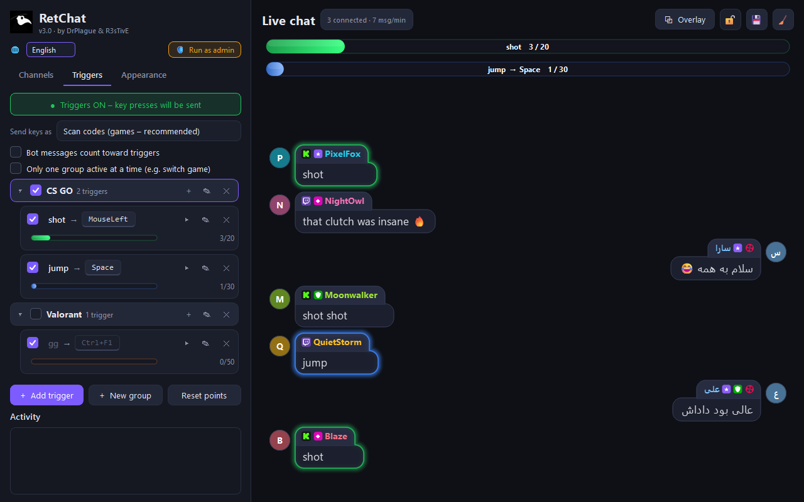
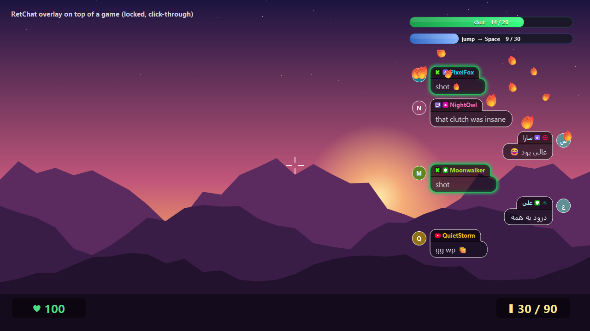

<div align="center">

**English** · [فارسی](README.fa.md)

# RetChat

**Read live chat from Twitch, Kick, YouTube, Aparat (kos madarashun) and OneFa in one window, show it as an overlay on your game or stream, and let your chat press keys in your game.**

Made by **DrPlague** and **R3sTivE** · Watch R3sTivE on Kick: **[kick.com/r3stive](https://kick.com/r3stive)**



</div>

---

## Contents

- [Features](#features)
- [🎮 Use it as an overlay](#overlay)
- [Privacy: RetChat does not send your data anywhere](#privacy)
- [Supported platforms](#supported-platforms)
- [Download and run](#download-and-run)
- [Tutorial](#tutorial)
  - [Top of the window](#top-of-the-window)
  - [Channels tab](#channels-tab)
  - [Triggers tab](#triggers-tab)
  - [Trigger editor](#trigger-editor)
  - [Appearance tab](#appearance-tab)
  - [Chat panel and overlay](#chat-panel-and-overlay)
  - [OBS](#obs)
- [Troubleshooting](#troubleshooting)
- [Run from source / build](#run-from-source--build)
- [License](#license)

---

## Features

- **Five platforms at once**: Twitch, Kick, YouTube, Aparat and OneFa in one chat, no browser needed.
- **Badges, emotes and profile pictures** from every platform, including animated GIF emotes.
- **Triggers**: when chat types a word enough times (e.g. `shot`), RetChat presses a key or mouse button in your game. Points per role, thresholds, cooldowns and groups (e.g. *CS GO*, *Valorant*).
- **Chat can also block keys, the keyboard or the mouse** for a few seconds, or **shut down the PC** (with a window to cancel it).
- **Moderation is respected**: messages deleted by moderators, and messages of banned or timed-out users, disappear from the app, the overlay and OBS. Aparat's moderator-only chat is never shown.
- **Works in games**: keys are sent as hardware scan codes, which games actually read.
- **Good-looking chat**: rounded message bubbles with the name on top, ready-made colour themes, glow on trigger messages, slide-in animations, fade-out, emoji rain (over the chat, over your whole screen, or as its own OBS source).
- **Overlay and OBS**: a transparent always-on-top chat window, and a web page you add to OBS as a Browser source (even from another PC).
- **Proxy per channel** for networks where some sites are blocked.
- **English and Persian** interface, with right-to-left support everywhere.

<a id="overlay"></a>
## 🎮 Use it as an overlay

**RetChat is made to be used as a chat overlay**, both on your own screen while you play and on your stream.



<sub>Example: RetChat's overlay on top of a game (the game scene is made up for this picture).</sub>

**1. On your screen, on top of your game**
- Click **⧉ Overlay** (top right of the chat). A transparent chat window opens that always stays on top of other windows, including your game.
- Drag it where you want it and resize it from the bottom-right corner.
- Click **🔓** to **lock** it: the overlay becomes **click-through**, so your mouse clicks go to the game underneath. Click **🔒** in the main window to unlock it again.
- Run the game in **windowed** or **borderless (fullscreen windowed)** mode. Exclusive fullscreen hides every window on top of the game.

**2. On your stream (OBS)**
- In **Appearance → OBS browser source**, tick **Serve chat as a web page** and copy a link.
- In OBS: **Sources → + → Browser**, paste the link. The background is transparent, so only the messages and bars appear on top of your stream. See [OBS](#obs) for details, including OBS on another PC.

**Tips for a good-looking overlay**
- **Theme → Glass** (see-through messages) and **Chat area opacity 0%**, so only the messages are visible.
- **Messages shown: 5** and/or **Fade out after: 10 s**, so the chat doesn't cover your game.
- **New message: Slide in from its side**, **Glow on trigger messages** and **Emoji rain** make chat reactions visible to viewers.
- Trigger **progress bars** appear at the top of the overlay and glow when a trigger fires.
- **Emoji rain over the whole screen**: tick **Appearance → Emoji rain → Also rain over the whole screen**, so emoji fall over your game, not only over the chat.
- **Emoji rain on stream**: add the OBS **Rain only** link as its own Browser source at full canvas size, so the rain covers the whole stream (see [OBS](#obs)).

<a id="privacy"></a>
## Privacy: RetChat does not send your data anywhere

- RetChat has **no account, no login, no analytics and no telemetry**. It never sends anything to the developers or to any third party.
- It only connects to **the chat servers of the channels you add** (and their picture servers for badges, emotes and profile pictures), to **read public chat**, the same way a browser does when you watch a stream. It does not post in chat.
- Those connections go through the route you choose for each channel (direct, your proxy, or the Windows proxy).
- Your settings are saved only on your own PC, in `%USERPROFILE%\.retchat2_settings.json`. Downloaded pictures are cached in `%USERPROFILE%\.ret_chat_cache`.
- Key presses, input blocking and shut down stay on your PC. The OBS page is only served on your own PC, or on your local network if you turn that on.

## Supported platforms

| Platform | What to paste | Badges | Profile pictures |
|---|---|---|---|
| **Twitch** | `twitch.tv/name` | ✓ official badge images | ✓ |
| **Kick** | `kick.com/name` | ✓ sub badges, mod / VIP / OG… | ✓ |
| **YouTube** | `youtube.com/@name` or a live `watch?v=` link | ✓ member / mod / owner | ✓ |
| **Aparat** | `aparat.com/name` | ✓ sub months, mod / VIP | ✓ |
| **OneFa** | `onefa.ir/name` | ✓ sub / mod / VIP / OG / friend | ✓ |

## Download and run

1. Go to the **[Releases](../../releases)** page and download `RetChat_x.y.exe`.
2. Double-click it. Nothing needs to be installed (Windows 10 / 11).
3. Windows may show *"Windows protected your PC"* because the app isn't signed: click **More info → Run anyway**.

---

## Tutorial

### Top of the window

| Item | What it does |
|---|---|
| **🌐 Language** | Switch between **English** and **فارسی**. RetChat restarts in the chosen language. |
| **🛡 Run as admin** | Games that run as administrator ignore keys from normal apps. Click this to restart RetChat with admin rights. When RetChat already has them, it shows **Admin ✓**. |

### Channels tab

| Item | What it does |
|---|---|
| **Paste a channel link** | Paste a Twitch, Kick, YouTube, Aparat or OneFa link and press **Add** (or Enter). |
| **Route box (next to Add)** | How the new channel connects: **Direct**, **Proxy** or **System proxy**. |
| **Proxy server** | Your proxy for channels set to *Proxy*: type (SOCKS5 / HTTP), host and port. v2ray / xray usually use SOCKS5 `127.0.0.1:10808`. |
| **Test** | Checks that the proxy can reach the internet. |
| **System: …** | Shows the proxy Windows is set to (used by *System proxy*). |
| **Channel row** | Platform logo, name, status (connected / error) and message count. |
| **Route (on each channel)** | Change how this channel connects. It reconnects right away. |
| **Connect / Disconnect** | Start or stop reading this channel's chat. |
| **✕** | Remove the channel. |
| **Connect all / Disconnect all** | Start or stop every channel. |

> If a channel shows an error such as *"DNS lookup failed"* or *"Can't connect"*, set its **Route** to **Proxy** or **System proxy**.

### Triggers tab

A **trigger** does something when chat types a word enough times: press a key, block keys / the keyboard / the mouse for a few seconds, or shut down the PC. Every matching message adds points depending on the sender's role (moderator, subscriber, VIP, regular). When the points reach the threshold, the action happens and the counter starts again.

| Item | What it does |
|---|---|
| **Triggers ON / PAUSED** | Master switch. While paused, no actions happen, no points are counted and no bars are shown. |
| **Send keys as** | **Scan codes** (recommended for games) or **Virtual keys** (for normal desktop apps). |
| **Bot messages count toward triggers** | Off by default, so a word relayed by a bot (e.g. RestreamBot) isn't counted twice. |
| **Only one group active at a time** | Turning one group on turns the others off (handy for switching games). |
| **Group header** | **☑ Active** turns all of the group's triggers on or off · **▾** fold / unfold · **+** add a trigger to this group · **✎** rename · **✕** delete. |
| **Trigger row** | **☑** enable / disable · word **→** action (e.g. `MouseLeft`, `⛔ W 5s`, `⏻ 30s`) · **▶** test (runs the action in 3 seconds, so you can switch to your game) · **✎** edit · **✕** delete · bar shows the points. |
| **+ Add trigger** | Opens the trigger editor. |
| **+ New group** | Creates a group, e.g. *CS GO* or *Valorant*. |
| **Reset points** | Sets every trigger's points back to 0. |
| **Activity** | A log of fired triggers, key presses and errors. |

### Trigger editor

| Field | What it does |
|---|---|
| **Group** | Which group the trigger belongs to. Type a new name to create a group. |
| **When chat says…** | The word, plus how it must match: whole message, contains the word, contains the text anywhere, or starts with the word. Persian and Arabic letter variants (ی/ي, ک/ك) are treated as the same. |
| **…then** | What happens when the trigger fires (see *Actions* below). |
| **Key** | For *Press a key*: the key, key combination or mouse button. Click **⏺ Record** and press it, or type it (e.g. `Ctrl+F1`, `Space`, `MouseLeft`). For *Block keys*: one or more keys separated by commas (e.g. `W, A, S, D` or `MouseLeft`). |
| **Hold for / Repeat** | For *Press a key*: how long the key is held (games often need 50–150 ms) and how many times it's pressed. |
| **For / Shut down after** | For blocking: how many seconds the block lasts. For *Shut down*: the delay before Windows shuts down (at least 10 s). |
| **▶ Test in 3 s** | Runs the action after 3 seconds so you can test it in your game (not available for *Shut down*). |
| **Who counts, and how much** | Which roles may trigger it, and how many points each role's message gives. |
| **Fire when points reach** | The threshold. |
| **Cooldown after firing** | Seconds during which nothing counts after the key was pressed. |
| **Each viewer counts only once per round** | Stops one person from filling the bar by spamming. |
| **Show progress bar** / **Bar colour** / **Show the key on the bar** | Whether the trigger has a bar above the chat, its colour (also used for the glow), and whether the bar shows `shot → MouseLeft` or just `shot`. |

**Actions (…then)**

| Action | What it does |
|---|---|
| **Press a key** | Presses the key or mouse button in your game. |
| **Block keys** | The listed keys / mouse buttons stop working for the set time, e.g. block `W, A, S, D` so you can't walk for 5 seconds. |
| **Block the whole keyboard** | Every key stops working for the set time. Keys that RetChat itself presses for other triggers still work. |
| **Block the mouse** | Mouse movement, buttons and wheel stop working for the set time. |
| **Shut down the PC** | Windows shuts the PC down after the delay. RetChat shows a window with **Cancel shut down**. Unsaved work is lost, so use a high threshold. |

> **Blocks always end by themselves** (at most 10 minutes). **Emergency: press Esc 5 times quickly** to unblock everything. Ctrl+Alt+Del always works too. If the game runs as administrator, click **Run as admin** so Windows lets RetChat block its input.

### Appearance tab

| Option | What it does |
|---|---|
| **Font / Size** | Chat font and text size. |
| **Layout** | **Bubbles** (rounded, name on top) or **Compact** (one line per message). |
| **Theme** | One-click colour presets: Midnight, Neon, Ocean, Forest, Sunset, Rose, Gold, Light and Glass (see-through). You can still fine-tune each colour afterwards. |
| **Colours** | Message text, name, message background, name background, message border and chat-area background. |
| **Message / chat area opacity** | How see-through the message boxes and the whole chat area are. |
| **Name size** | Name size compared with the message text. |
| **Corner roundness / Border thickness** | Shape of the message boxes. |
| **New message** | How new messages appear (slide in from their side / right / left, fade in, none). Older messages glide up. |
| **Fade out after** | Each message disappears after this many seconds (*never* = keep). Tick **Only fade in the overlay and OBS** to keep every message in the app window. |
| **Text direction** | Automatic per message, always right-to-left, or always left-to-right. |
| **Messages shown** | Only the newest N messages are shown (e.g. 5). |
| **Show …** | Viewer name colours, platform icons, badges, time, older messages, bot messages, profile pictures. |
| **Glow on messages that count toward a trigger** | Those messages glow in the trigger's colour. |
| **Special effects** | Per site, give **Subscribers**, **VIPs** and **OG** users an effect on their messages: Glow, Pulse, Rainbow glow, Rainbow border or Shine (or none). |
| **Emoji rain** | A message's emoji or GIF emote rains over the chat (optionally only for trigger messages), with amount and a wait between rains. **Also rain over the whole screen** lets it fall over your whole monitor, on top of every window: pick the monitor, **Test** drops a test rain, clicks go through it, and it shows over borderless / windowed games. **Rain on the OBS chat page too** turns rain on the OBS chat page on or off (the OBS *Rain only* page always rains). |
| **Bot names** | Names treated as bots. |
| **Progress bars** | Bar height and text size. |
| **OBS browser source** | See [OBS](#obs). |

### Chat panel and overlay

| Button | What it does |
|---|---|
| **⧉ Overlay** | Opens a transparent, always-on-top chat window. Drag it to move; resize from the corner. |
| **🔓 / 🔒** | Locks the overlay so clicks go through it to the game underneath. Click again to unlock. |
| **💾** | Saves the chat as a JSON file. |
| **Links / right-click** | In the app window, links in messages are clickable (they open in your browser). Right-click a message to **copy the message, its text or its link**. (Not in the overlay or OBS.) |
| **🧹** | Clears the chat. |
| **Progress bars** | Bars of active triggers. They animate, and glow in their colour when a trigger fires. |
| **Deleted messages** | When a moderator deletes a message, bans or times out a user, or clears the chat, those messages are removed from the app, the overlay and OBS (all five platforms). |

### OBS

1. **Appearance → OBS browser source**: tick **Serve chat as a web page**.
2. Click **Copy** next to a link: **Chat + bars**, **Chat only**, **Bars only** or **Rain only**.
3. In OBS: **Sources → + → Browser**, paste the link, size e.g. 400 × 600.

**Rain only** shows nothing but the emoji rain. Add it as its own Browser source at your **full canvas size** (e.g. 1920 × 1080), so the rain covers the whole stream. To make it rain only there, untick **Rain on the OBS chat page too** under *Emoji rain*.

**OBS on another PC**: tick **Allow other PCs on my network**, pick this PC's address (usually `192.168.x.x`) and use that link on the OBS PC. If it doesn't load, click **Open firewall** and make sure both PCs are on the same network.

You can add `&fade=30` to a link to hide messages after 30 seconds.

---

## Troubleshooting

| Problem | Fix |
|---|---|
| Keys don't work in the game | Click **Run as admin** if the game runs as administrator. Keep **Send keys as → Scan codes**. Raise **Hold for** to ~100 ms. Use **▶ Test** to check. |
| A channel can't connect | Set its **Route** to **Proxy** (and press **Test** on the proxy) or **System proxy**. The error line tells you the exact reason. |
| A word is counted twice | Keep **Bot messages count toward triggers** off. |
| Keyboard or mouse is still blocked | Press **Esc 5 times quickly**. Blocks also end by themselves after the set time. |
| Blocking doesn't work in the game | Click **Run as admin** if the game runs as administrator. |
| Rain over the whole screen isn't visible in the game | Run the game in **borderless** or **windowed** mode; exclusive fullscreen draws over every window. |
| OBS on another PC can't open the page | Click **Open firewall**; both PCs must be on the same network (Windows network type: *Private*). |

## Run from source / build

```bash
pip install -r requirements.txt
python app.py
```

Build the `.exe` with PyInstaller:

```bash
pyinstaller RetChat2.spec
```

Test one channel without the window: `python connectors.py https://kick.com/r3stive 30`

<details>
<summary>How RetChat reads each platform</summary>

| Platform | Connection |
|---|---|
| Twitch | anonymous IRC over WebSocket; badges and profile pictures through Twitch's public GraphQL |
| Kick | Kick realtime WebSocket (Centrifugo), profile pictures from the public channel API |
| YouTube | the live-chat feed ("Live chat", not "Top chat") |
| Aparat | socket.io at `lws.aparat.com` |
| OneFa | socket.io at `onefa.ir` |

</details>

## License

[MIT](LICENSE) © 2026 DrPlague and R3sTivE. Free to use and modify, as long as the copyright notice stays.

---

<div align="center">

Made with ❤️ by **DrPlague** & **R3sTivE** · [kick.com/r3stive](https://kick.com/r3stive)

</div>
